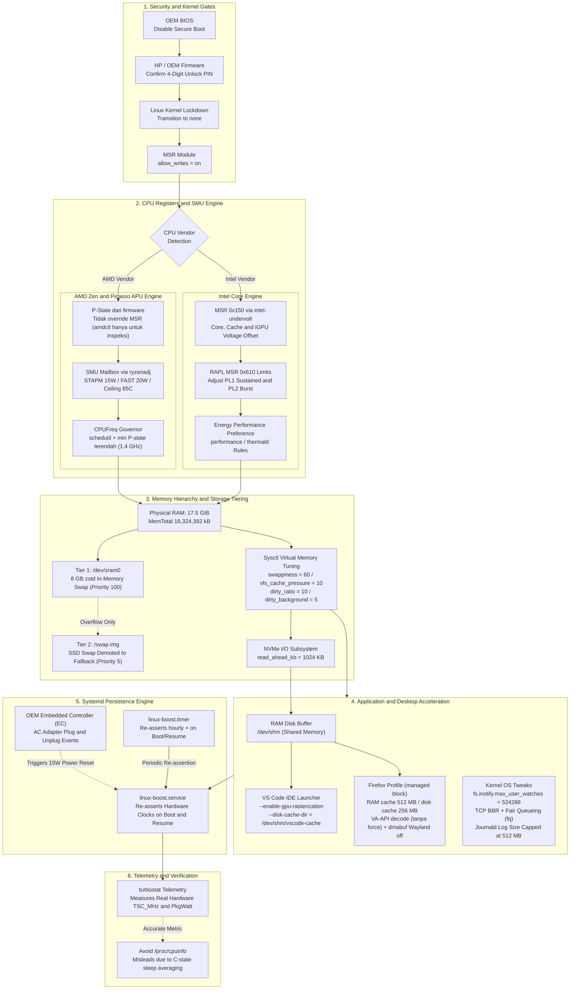

# System Architecture & Tuning Flow

Blueprint arsitektur teknis optimasi performa Linux Ubuntu pada laptop spek hemat (AMD APU Zen/Picasso & Intel Core).

---

## Architecture Flowchart

---

## Ringkasan 6 Layer Arsitektur

1. **Security & Kernel Gates**: Unlock MSR user-space write dan matikan kernel lockdown via BIOS Secure Boot OFF.
2. **CPU Registers & SMU Engine**: P-state dibiarkan sesuai firmware (override MSR tidak dipakai karena CPU hanya mengekspos 3 P-state), batas TDP diatur via ryzenadj (15 W STAPM, ceiling 85 °C).
3. **Memory Hierarchy & Storage Tiering**: 17.5 GiB RAM + 8 GB ZRAM zstd priority 100. SSD swap turun ke priority 5, tanpa swapoff berkala.
4. **App & Desktop Acceleration**: VS Code GPU rasterization + cache ke `/dev/shm`. Firefox RAM cache 512 MB, disk cache 256 MB, VA-API tanpa force, dmabuf Wayland off (hindari crash screencast).
5. **Systemd Persistence Engine**: `linux-boost.service` dan `linux-boost.timer` (boot/resume + interval 1 jam) melawan reset daya dari Embedded Controller (EC).
6. **Telemetry & Verification**: Pengukuran clock kristal fisik valid via `turbostat` (hindari distorsi `/proc/cpuinfo`).
