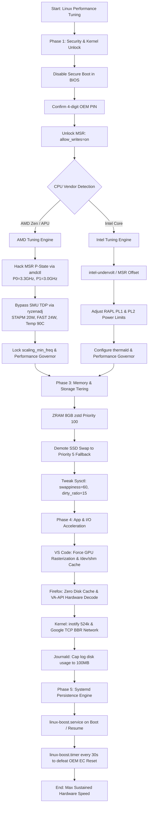

# Linux Hardware & System Performance Tuning Playbook

Automated playbooks, hardware register modifications, kernel optimizations, and system tuning guides for squeezing peak sustained performance out of locked CPUs (AMD Zen/Picasso & Intel Core), RAM, GPU acceleration, and I/O subsystems on Ubuntu and Debian-based Linux desktops.


---

## 🎯 Architecture & Execution Flow



---

## 📊 AMD vs Intel Optimization Matrix

| Optimization Vector | AMD APU (Zen / Zen+ / Picasso) | Intel Core (8th - 13th Gen) |
| :--- | :--- | :--- |
| **P-State Overclock** | Direct MSR overwrite (`0xC0010064` via `amdctl`). Modifies base FID/DID. | Multiplier locked on non-K; use BCLK or Turbo Ratio limits if unlocked. |
| **Power Limit (TDP)** | SMU Mailbox bypass via `ryzenadj` (STAPM, PPT FAST, PPT SLOW). | MSR `0x610` (MSR_PKG_POWER_LIMIT) via RAPL or `intel-undervolt`. |
| **Undervolting** | Register VID manipulation in P-State tables. | Direct voltage offset via MSR `0x150` (Core, Cache, Uncore, iGPU). |
| **Memory Topology** | Critical: Flex Dual Channel required for Radeon Vega iGPU bandwidth. | Dual Channel recommended for Intel UHD/Iris Xe graphics. |
| **EC Reset Defense** | Systemd timer required (30s interval) to counter HP/Lenovo power resets. | Systemd timer required to counter Intel DPTF / OEM thermal manager resets. |
| **Kernel Prerequisites** | Secure Boot OFF + `allow_writes=on` on `/sys/module/msr`. | Secure Boot OFF + `msr` module enabled. |

---

## 📁 Repository Structure

- [`docs/`](./docs/README.md) - Deep dive guides explaining the physics, registers, and kernel mechanisms.
- [`scripts/`](./scripts/README.md) - Modular automation scripts for hardware tuning, ZRAM setup, and app acceleration.
- [`systemd/`](./systemd/README.md) - Systemd unit files and anti-EC reset defense timers.
- [`configs/`](./configs/README.md) - Production sysctl, desktop, and journald configuration templates.

---

## 🚀 Quick Start (Automated Installation)

Clone this repository and run the unified installer:

```bash
git clone https://github.com/Suryaalghifari/linux-performance-tuning.git
cd linux-performance-tuning
chmod +x scripts/*.sh

# Run the installer (interactive or automatic detection)
sudo ./scripts/install.sh
```

---

## 🔍 Verification & Telemetry

Don't rely on `/proc/cpuinfo` under `acpi-cpufreq` as it averages duty cycles during C-state sleep. Verify real hardware execution clocks using `turbostat`:

```bash
sudo turbostat -s Bzy_MHz,TSC_MHz,Busy%,PkgWatt -i 1
```

- **`TSC_MHz`**: Shows true physical crystal clock (e.g. `3294 MHz` = 3.3 GHz locked).
- **`Bzy_MHz`**: Shows actual unhalted core frequency under execution load.
- **`PkgWatt`**: Shows package power draw under tuned limits.

---

## 🛡️ Rollback & Safety

To revert all changes back to standard factory defaults:

```bash
sudo ./scripts/uninstall.sh
```

---

## 📜 License

MIT License. Crafted for developers, DevOps engineers, and Linux power users seeking to maximize hardware lifespan and workstation responsiveness.
